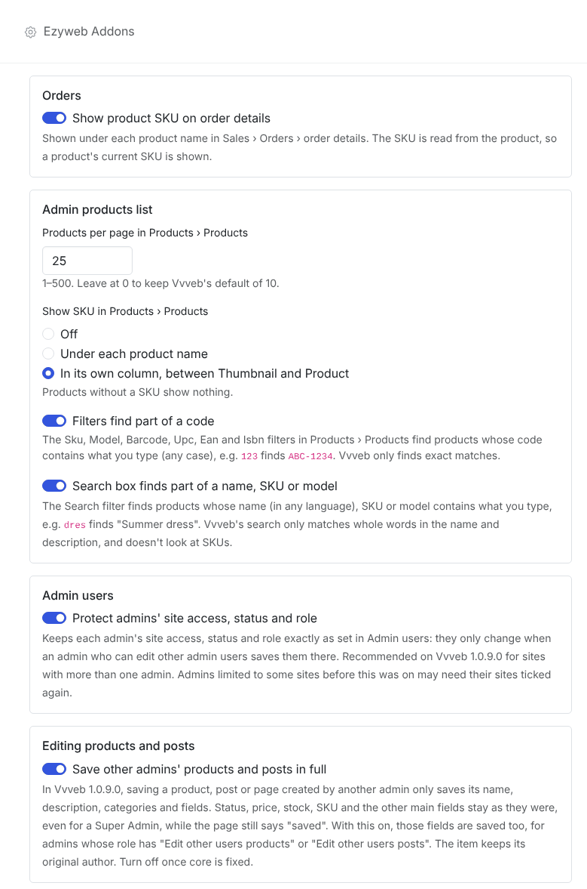
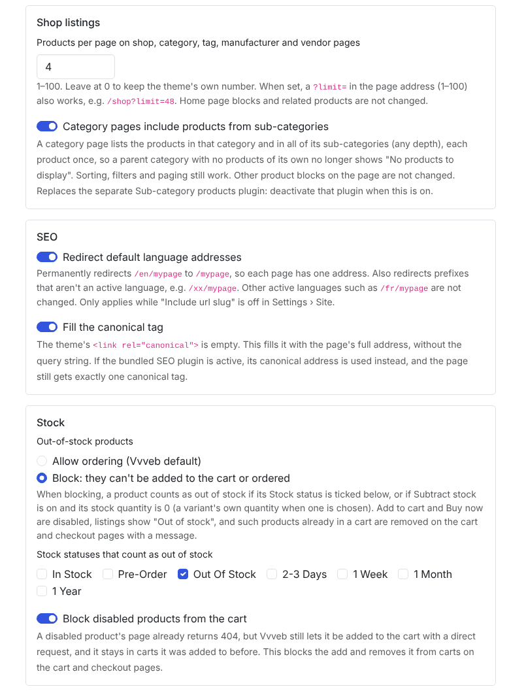
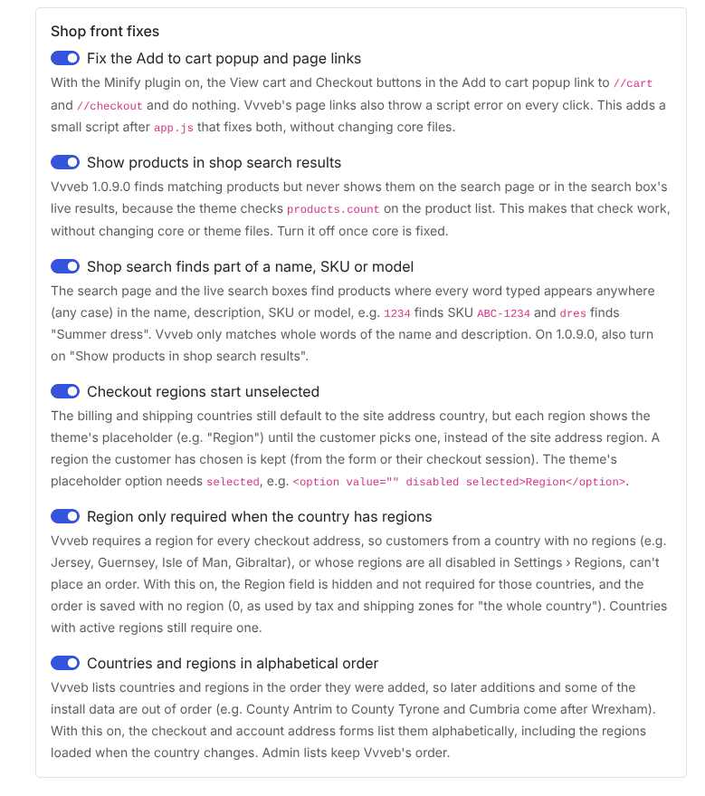

# Ezyweb Addons for Vvveb

A collection of small admin, shop and checkout improvements for [Vvveb CMS](https://www.vvveb.com), including
workarounds for bugs in Vvveb 1.0.9.0 that have been reported to the Vvveb project. Each feature has its own
switch in **Plugins › Ezyweb Addons › Settings**, and everything is off after install, so you only turn on what you
need. No core files are changed.

## Features

### Orders and admin Products list

- **SKU on order details:** shows "SKU: …" under each product in Sales › Orders › order details (the product's
  current SKU).
- **Admin products per page:** page size for Products › Products (Vvveb's default is 10).
- **SKU in the admin Products list:** under each product name, or in its own column between Thumbnail and Product.
- **Filters find part of a code:** the Sku, Model, Barcode, Upc, Ean and Isbn filters in Products › Products find
  codes containing what you type, in any case (Vvveb only finds exact matches).
- **Search box finds part of a name, SKU or model:** the Products › Products search finds products whose name (any
  language), SKU or model contains the text, instead of whole words in the name and description.
  Suggested for core in [#544](https://github.com/givanz/Vvveb/issues/544) (point 4).

### Admin users, products and posts

- **Save other admins' products and posts in full:** in Vvveb 1.0.9.0, saving a product, post or page created by
  another admin only saves its name, description, categories and fields; status, price, stock and the other main
  fields stay unchanged while the page says "saved". With this on, they save too, for roles allowed to edit other
  admins' items, and the original author is kept. Fix for [#545](https://github.com/givanz/Vvveb/issues/545); turn off once core is fixed.
- **Protect admins' site access, status and role:** keeps each admin's site access, status and role exactly as set in
  Admin users: they only change when an admin who can edit other admin users saves them there. Recommended on
  Vvveb 1.0.9.0 for sites with more than one admin.

### Shop listings and search

- **Shop products per page:** page size for the main product list on shop, category, product tag, manufacturer and
  vendor pages; `?limit=` (1–100) in the address also works.
- **Category pages include products from sub-categories:** a category page also lists the products of all its
  sub-categories (each product once).
- **Show products in shop search results:** Vvveb 1.0.9.0 finds products for a search but never shows them on the
  search page or in the live search box. Also stops search text containing `-`, `'`, `"` or `:` breaking the
  search page. Fix for [#544](https://github.com/givanz/Vvveb/issues/544) (points 2 and 3); turn off once core is fixed.
- **Shop search finds part of a name, SKU or model:** the search page and live search find products where every
  word appears anywhere in the name, description, SKU or model, in any case. Needs "Show products in shop search
  results" on 1.0.9.0. Suggested for core in [#544](https://github.com/givanz/Vvveb/issues/544) (point 4).

### Stock

- **Out-of-stock products:** allow ordering (Vvveb's default) or block them. When blocking, a product is out of
  stock if its Stock status is one of the ticked statuses (default: Out Of Stock), or if Subtract stock is on and its
  quantity (or the chosen variant's) is 0. It can't be added to the cart by any route, its Add to cart and Buy now
  buttons are disabled, listings show a disabled "Out of stock" button, and if it's already in a cart it's removed
  on the cart and checkout pages with a message.
- **Block disabled products from the cart:** the same for disabled products (status off). Their page already
  returns 404, but Vvveb 1.0.9.0 still lets them be added with a direct request.

### Checkout and account address forms

- **Checkout regions start unselected:** the billing and shipping Region lists start on the theme's "Region"
  placeholder instead of the shop's own region, so customers don't submit the shop's region by mistake. Needs the
  theme's placeholder option to be `selected`.
- **Region only required when the country has regions:** customers from countries without (active) regions, such
  as Jersey, Gibraltar or Singapore, can place an order; Vvveb 1.0.9.0 always requires a region.
- **Countries and regions in alphabetical order:** Vvveb lists them by id, so later additions are out of order (e.g.
  County Antrim to County Tyrone after Wrexham). Sorts them by name (ignoring case and accents) on the checkout and
  account address forms, including the regions loaded when the country changes.

### SEO

- **Redirect default language addresses:** a 301 from `/en/mypage` to `/mypage` (query string kept), and from
  prefixes that aren't an active language. Active languages such as `/fr/` and form posts are left alone. Only while
  "Include url slug" is off. For [#520](https://github.com/givanz/Vvveb/issues/520).
- **Fill the canonical tag:** fills the theme's empty `<link rel="canonical">` with the page's full address (no query
  string). With the bundled SEO plugin active, its canonical URL is used, and the page still gets exactly one tag.
  For [#520](https://github.com/givanz/Vvveb/issues/520).

### Shop front fixes

- **Fix the Add to cart popup and page links:** fixes the `//cart` and `//checkout` links in the Add to cart popup
  (when Minify is on), the `element is not defined` error on every ajax link click, and the duplicate click listener
  in Vvveb 1.0.9.0's `app.js`. Fix for [#529](https://github.com/givanz/Vvveb/issues/529); turn off once core is fixed.

## Settings

**Plugins › Ezyweb Addons › Settings**, shown with the features switched on so every option is visible. After
install everything is off.

## Requirements

- Vvveb 1.0.9.0 (the "fix" switches target bugs in that release; check whether each is still needed after updating
  Vvveb).
- PHP 8.3 (tested) or 8.4 (code checked for PHP 8.4 deprecations, none found). The "Countries and regions in
  alphabetical order" sort uses the intl extension when installed.
- Front end: tested with the Landing theme (Oct 2026).

### Theme notes

- **Out-of-stock blocking:** remove the theme's own quantity checks, or products at quantity 0 can't be ordered even
  when ordering is allowed: `data-v-attr-if-disabled="product.stock_quantity < 1"` on the product page buttons,
  `max="{$product.stock_quantity}"` on the quantity input, and the listing pair `data-v-if="prod.stock_quantity < 1"`
  / `> 0`. A cart page notification block with `data-v-type="stock"` shows the removal messages.
- **Checkout regions start unselected:** the Region placeholder needs `selected`:
  `<option value="" disabled selected>Region</option>` (stock Landing has no `selected`, so the browser picks the
  first region).

## Installation

1. Download `ezyweb-addons.zip` from the [latest release](../../releases/latest).
2. In the Vvveb admin go to **Plugins › Add new**, upload the zip and activate **Ezyweb Addons**.
3. Open its **Settings**, switch on the features you want and click **Save settings**.

Manual install: copy the files to `plugins/ezyweb-addons/` and the `public/` folder to
`public/plugins/ezyweb-addons/`, then activate the plugin. The folder must be named `ezyweb-addons` (the
plugin's slug).

Settings are stored per site. Saving clears the cache and page cache.

## How it works

- **SKU:** the admin order query already joins the `product` table, so `$product['sku']` is available; `admin/template/order-sku.tpl` adds it before the price line. The SKU is the product's *current* SKU (it isn't saved with the order).
- **Admin per page:** admin `Base::init()` reads `?limit=` before plugins load, so the plugin redirects `module=product/products` to the same address with `&limit=N&ezy_limit=1`. The `ezy_limit` marker means a limit the plugin added: if the setting has changed since (a reloaded page, Back, a page link or a bookmark), it is updated to the new number, and if the feature is turned off it is removed. A `?limit=` without the marker was typed by hand and is left alone, as are actions and POSTs. Changing the page size goes back to page 1.
- **Shop per page:** hooks the `Vvveb\Component\Products` `__construct` event (fired after `url` options are resolved) and sets `limit`, only on listing controllers (`product/index`, `category`, `tag`, `manufacturer`, `vendor`) and not for `related`/`variant` lists. Home page blocks and related products keep the theme's `data-v-limit`.

- **Default language redirect:** hooks `Vvveb\Controller\Base` `init:after`. If the URL's language prefix is the default language, or isn't an active language, it 301s to the address without the prefix. The default slug falls back to the site's `language_id`, then the language marked default, because upgraded sites can have a blank default slug.
- **Canonical:** loaded on `Vvveb\System\Core\View` `compile:after` at priority 2000. Rules loaded earlier are lost, because themes copy `<head>` from `index.html` with `data-v-save-global`, and priority 2000 runs after the SEO plugin. With the SEO plugin active, the theme's tag outputs `$this->seo['canonical']` (or the page URL), then clears it, so the SEO plugin's holder tag can't add a second one. If core `common.tpl` already fills the canonical, the plugin leaves it alone.

- **SKU in Products list:** the admin products query already selects `product.*`, so `$product['sku']` is in the listing loop. `admin/template/products-sku-title.tpl` adds it after the name link. `products-sku-column.tpl` adds a header before the Product `th` (matched by its `style="min-width:320px;"`) and a cell after `td.img`. Loaded only on `module=product/products`.
- **app.js fix:** `app.js` is a classic script (also when bundled by Minify), so `navigateTo` is a global and can be replaced. `app-js-fix.js` strips the trailing slash from `VvvebApp.path`/`publicPath` and replaces `navigateTo` with a version that finds the clicked link from `window.event`. It handles each click once, and follows the link itself when it can't be loaded by ajax, because app.js cancels the click afterwards. It's added with `body|append` on `compile:after` (priority 2000), with `data-no-minify` and `?v=<filemtime>`.

- **Out-of-stock and disabled products:** Vvveb 1.0.9.0 never checks stock or status when adding to the cart (`Cart::add()`), and its `hasStock()` is never called. The plugin:
  - hooks `Vvveb\Controller\Cart\Cart` `action` (fired before `Cart::add()`, for ajax adds, form posts and `cart?product_id=`) and changes the action to one that does nothing when the product can't be ordered;
  - hooks `Vvveb\Controller\Base` `init:after` on `cart/cart` and `checkout/checkout`: drops a blocked buy now `product_id` (checkout adds it after this event) and removes cart items that can't be ordered any more. Messages go to the page notifications with type `stock`; when an emptied checkout redirects to the cart, they're kept in the session for the cart page;
  - loads `app/template/stock.tpl` on `compile:after` (priority 2000): `disabled` on the product page's `button[data-v-product-add_cart_url]` and `button[data-v-product-buy_url]` (`$product`), the quantity input's `max` set to the tracked stock, and in listings (`$prod`) the `a[data-v-product-add_cart_url]` link replaced by a disabled "Out of stock" button;
  - adds `public/stock.js`, which wraps `VvvebTheme.Cart.add` so a refused add (the response carries `<template id="ezy-stock-blocked" data-message="…">`) shows the message instead of "was added to cart". Core re-enables the clicked button after every ajax add, and a non-200 response would leave its spinner running, so the server answers 200 with the marker;
  - reads `status`, `stock_status_id`, `subtract_stock`, `stock_quantity` (and `product_variant.stock_quantity`) directly from the database, so disabled products are found too.
  - Theme: remove the theme's own quantity checks (`data-v-attr-if-disabled="product.stock_quantity < 1"`, the `max="{$product.stock_quantity}"` on the quantity input, and the listing pair `data-v-if="prod.stock_quantity < 1"` / `> 0`). Otherwise products at quantity 0 can't be ordered even when ordering is allowed. A cart page notification block with `data-v-type="stock"` shows the removal messages.

- **Partial filters in Products › Products:** `admin/sql/*/product.sql` `getAll()` compares `product.sku = :sku` (also model, barcode, upc, ean, isbn), and the search box uses the full-text index; SQL can't be changed from a plugin. On `module=product/products` the plugin runs one `SELECT DISTINCT p.product_id … LEFT JOIN product_content … WHERE LOWER(col) LIKE '%value%' ESCAPE '!'` (value html-decoded, lowercased, `!`/`%`/`_` escaped, then `$db->escape()`), removes those filter keys and passes `filter[product_id]` (no matches: `[0]`). Status, manufacturer, vendor, site, price and stock filters still apply, and sorting and paging work. `Request->get` is a reference to `$_GET`, so on the View `render` event the original filter is put back (page links keep `filter[sku]=…`) and `$view->filter` is set to the typed values, html-decoded so the fields show them as typed.

- **Shop search results:** core `app/template/components/products.tpl` sets `$products` to the list of items, while themes test `data-v-if="products.count > 0"` and `"products.search && products.count > 0"` on it (compiled to `$products['count']`, never set). `app/template/search-fix.tpl` (loaded on `compile:after`, priority 2000) adds `body|prepend = <?php \EzywebAddons::wrapProductLists($this);?>`, which runs after the components are loaded. It replaces each `$view->_component['products'][i]['product']` with an `EzywebAddonsProductList` (an `ArrayObject` that iterates and counts the products and also answers `['count']`, `['search']`, … from the component data). Product keys are numeric ids, so they can't clash. Harmless once core sets `$products` to the component data.

- **Search terms:** SQLite FTS5 reads `- ' " : ( ) * ^` in the search text as query syntax ("drs-5678" fails with `no such column: 5678` and the search page stops part way). With either search switch on, `Products` and `Posts` `__construct` listeners (priority 900) replace anything that isn't a letter or digit with a space (after html-decoding the request filter's `&#039;`).
- **Shop partial search:** a `Products` `__construct` listener (priority 1000, id `EzywebAddonsshopsearch`) looks up the ids where every word is `LIKE '%word%'` in `pc.name`, `pc.content`, `p.sku` or `p.model` (current language), passes them as `product_id` (the component uses `product_id` when `source` is `autocomplete`, its default; `[0]` when nothing matches), and removes `search`. `prepareProductLists()` (the `body|prepend` rule) puts the words back into the component results (read from the instance's options as `ezy_search`), because themes only show product results when `products.search` is set.

- **Saving other admins' items:** core `saveEditData()` (`system/traits/edit.php`) builds the edit data `+ $global`, so it carries the saving admin's `admin_id`, and the edit SQL adds `AND admin_id = :admin_id` to `UPDATE product|post`. For anyone else's item that updates nothing (content, categories and fields are separate statements and do save). The plugin listens to the trait's `save` event (`Vvveb\Controller\Content\Edit`, fired after a successful save, also for products), and when the item's owner isn't the current admin and the admin has `edit_other_products`/`edit_other_posts`, calls the model's `edit()` again with only the main row (minus `admin_id`, so the owner is kept), the id and an empty content list (the product `edit()` filters content unconditionally): no taxonomy, site or field data, so only that `UPDATE` runs. Roles without the capability still get core's "Permission denied!" on existing items, including their own; that needs the core fix (`system/traits/edit.php`).

- **Admin site access, status and role:** listens to the database driver's `execute` event (`Vvveb\System\Db\Sqlite|Mysqli|Pgsql`, fired with `$sql, $params` before every query). For `UPDATE admin` the row is in `$params['admin']`, so when it contains `site_access`, `status` or `role_id` the plugin looks up the target admin by the update's `admin_id`/`email`/`username` and puts the stored values back, unless the request is the admin user form (`admin/user` `save`) saved by an admin with `edit_other_admin`. Inserts (new admins) are untouched.

Settings are stored with `setSetting('ezyweb_addons', …)` per site. Saving clears the cache and page cache.

- **Alphabetical countries and regions:** core's `CountrySQL`/`RegionSQL` `getAll()` order by status then id. On `checkout/*` and `user/*` pages a `View` `render` hook sorts `$view->countries` and `$view->regions` by name just before the template draws them. For the regions endpoint (`checkout/checkout`, `action=regions`, JSON, called by checkout.js when the country changes), an `init:after` hook adds a `Response` output filter that decodes core's JSON, sorts it and encodes it again. Names are compared with `Collator` (root locale, primary strength: case and accents ignored) when the intl extension is installed, otherwise lower-cased and transliterated to ASCII. Core still builds the lists; only the order changes. The same sort in core is a one-line `ORDER BY` change in `admin/sql/*/country.sql` and `region.sql`, which would also cover the admin.

## Adding a feature

Add a default to `EzywebAddons::DEFAULTS`, a field to `public/admin/settings.html` (`data-v-setting="key"` for values, `data-v-setting-check="key"` for switches), save it in `admin/controller/settings.php`, and call it from `admin()` or `app()` in `plugin.php`.

## Version history

- **0.20** (2026-11-24): current release, tested with Vvveb 1.0.9.0 and the Oct 2026 Landing theme. Copyright notice
  and LICENSE added. Earlier versions were development releases.

## Licence

Copyright (C) 2026 Ezyweb.uk. Released under the GNU Affero General Public License v3 or later (see LICENSE). Built for
Vvveb CMS by Ziadin Givan, which is also AGPLv3. The settings page uses the admin page layout of Vvveb's bundled
payment plugin, Copyright (C) 2022 Ziadin Givan.
